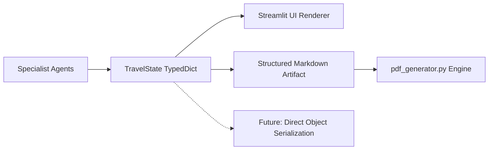
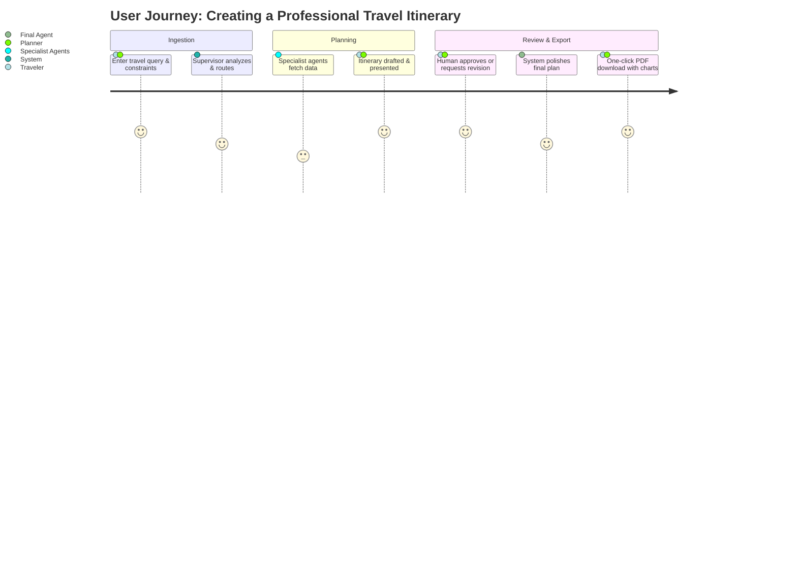
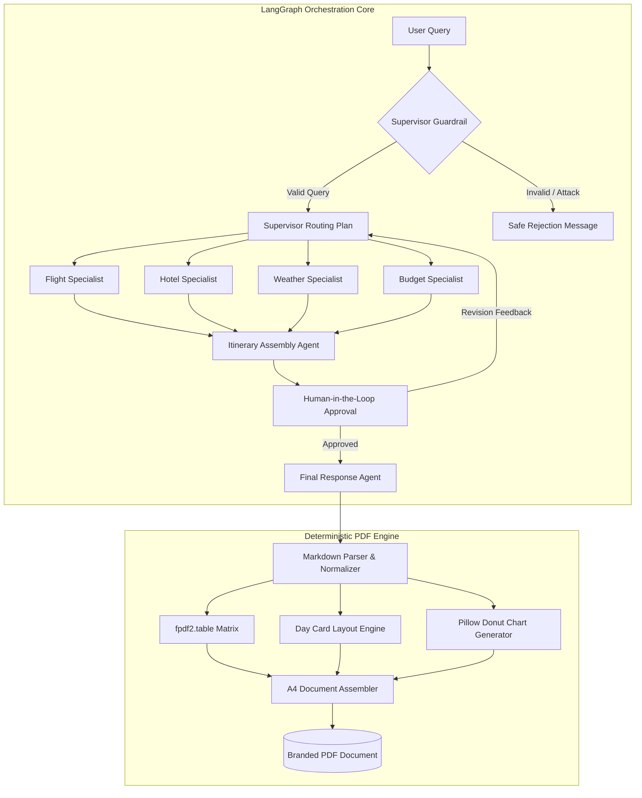

# Product Requirements Document (PRD)
## Agentic AI Travel Assistant — SagaTraveller PDF Generation Engine & Multi-Agent Architecture

---

### Document Information
- **Product Name**: SagaTraveller — Agentic AI Travel Assistant
- **Document Owner**: Lead Systems Architect & Product Engineering Team
- **Stakeholders**: Product Management, AI Engineering, Full-Stack Development, QA, UI/UX Design
- **Document Version**: 2.0 (Production Release Specification)
- **Status**: Approved & Baseline Verified
- **Last Updated**: 2026-10-16
- **Repository**: [GitHub Repository](https://github.com/Hamed18/Agentic-AI-Travel-Assistant)
- **Design & Test Artifacts**:
  - PDF Generation Engine: `pdf_generator.py`
  - Multi-Agent Orchestration: `agents.py`, `graph.py`, `state.py`
  - Web UI Application: `frontend.py`
  - Solved Issues Documentation: `SOLVED_PROBLEMS_DOCUMENTATION.md`
  - End-to-End Latency Benchmark: `test_run.py`

---

## 1. Document Overview

This Product Requirements Document (PRD) establishes the definitive product and engineering specification for the **SagaTraveller Agentic AI Travel Assistant**, with specialized depth on the publication-grade **PDF Generation Engine**, **Multi-Agent Orchestrator**, and **UI/Engine Content Parity Guarantee**.

It formalizes the architecture, input/output contracts, pagination and overflow algorithms, budget validation logic, safety mitigations, performance baselines, and quality criteria governing both real-time Streamlit web experiences and physical A4 export deliverables.

---

## 2. Problem Statement and Opportunity

### 2.1 The Problem Being Solved
Automated AI itinerary generators frequently output rich interactive markdown within web interfaces, but experience severe information degradation when converting plans into downloadable, shareable formats (e.g. PDFs):
1. **Silent Content Loss**: Structured tables (flight legs, hotel bookings, weather tables, budget line items) and granular day-wise cards vanish or get truncated when transformed to PDF.
2. **Visual & Structural Disconnect**: Day plans render as chaotic unformatted tables or monolithic blocks rather than readable, color-coded day cards with distinct activity, location, and expense breakdowns.
3. **Absence of Visual Financial Analytics**: Travelers and travel agents require clear visual allocation of expenses (pie/donut charts) alongside numerical itemizations.
4. **Branding & Professional Polish Void**: Generic PDF tools generate plain text documents without corporate identity, travel agency mottos, document headers, page numbering, or clear print typography.

### 2.2 Who Experiences This Problem
- **Independent Leisure & Business Travelers**: Need a tangible, offline-accessible document for flights, visas, and daily itinerary execution.
- **Boutique Travel Agents & Tour Operators**: Need a white-labeled, branded itinerary with logos and mottos (`SagaTraveller: Your Journey, Our Story`) to deliver directly to clients.
- **Enterprise Travel Planners**: Require 100% mathematical consistency between line-item budgets and visual charts for cost approvals.

### 2.3 Current Alternatives and Limitations
- **Browser Print-to-PDF**: Inconsistently breaks pages across table rows, cuts images in half, drops background styling, and includes browser chrome/URL footers.
- **Generic Markdown-to-PDF Converters**: Fail on custom table widths, lack native chart generation, and silently omit complex multi-column layouts.
- **Manual Travel Agent Templates**: Require 2–4 hours of manual transcription from planning tools into Word/Canva templates per itinerary.

### 2.4 Business and User Opportunity
By pairing a **LangGraph Multi-Agent Engine** (running specialized routing, flight search, hotel discovery, weather forecasting, and budget optimization) with a zero-loss **Deterministic PDF Publishing Engine**, SagaTraveller delivers:
- One-click instant export from interactive chat into a publication-grade A4 travel brochure.
- 100% content parity guarantee: every character, table row, and cost figure visible in the UI preview is guaranteed to exist in the generated PDF.
- Turnaround time reduced from hours of manual collation to under 3 seconds for document rendering.

---

## 3. High-Priority Architecture Improvements (P0 & P1)

### 3.1 P0 — Foundational Improvements (Pre-Implementation Baseline)

#### 1. Content Parity Specification vs. Visual Similarity
The system defines a strict distinction between **Content Parity** (mandatory mathematical completeness) and **Visual Similarity** (responsive adaptation for print):
- **Content Parity Rules (Zero-Loss Guarantee)**:
  - Every day card, time slot, activity name, location, and cost shown in the UI must exist in the PDF.
  - Section hierarchy and chronological day order ($Day\ 1 \to Day\ N$) must be identical.
  - No table column or row (flights, hotels, weather, budget) may be dropped or truncated.
  - Totals in the budget overview must mathematically match the sum of individual day activities and accommodation costs.
- **Visual Similarity Rules**:
  - The web UI utilizes dynamic dark-mode styling (`#0d1322` background with `#3b82f6` neon accents).
  - The PDF engine utilizes clean, high-contrast, print-optimized CMYK-safe light styling (`#ffffff` canvas, `#1e3a8a` navy headers, `#f8fafc` table striping, and `#0f172a` primary text) for readability and ink efficiency.

#### 2. Markdown Input Contract & Syntax Rules
The PDF parser implements a deterministic state-machine parser supporting the following syntax matrix:

| Element | Supported Markdown Syntax | Rendering Behavior in PDF | Failure Fallback |
|---------|---------------------------|---------------------------|------------------|
| Heading 1 | `# Title` | 24pt Bold Navy, full-width section header | Formatted as 18pt bold text |
| Heading 2 | `## Section` | 16pt Bold Navy with decorative underline | Formatted as 14pt bold text |
| Heading 3 | `### Day X: ...` | 13pt White text on solid Navy rounded card | Formatted as bold heading |
| Bold / Italic | `**text**`, `*text*` | Bold / Italic Helvetica font switches | Stripped to plain text if font missing |
| Tables | `\| Col 1 \| Col 2 \|` | Native `fpdf2.table` cell grid, autowrapped | Parsed into structured list |
| Bullet Lists | `- item` or `* item` | 5mm indented bullet (`•`) with hanging indent | Left-aligned plain text |
| Donut Chart | `render_budget_pie_chart_image()` | High-DPI Pillow PNG image centered in page | Renders text summary table |
| Raw HTML | `<div...>` or `<span>` | Stripped safely via regex sanitization | Stripped cleanly |

#### 3. Pagination, Header Repetition, and Overflow Rules
- **Widow & Orphan Control**: Headings (H1, H2, H3) require a minimum of $35\text{ mm}$ remaining vertical space on the current page; otherwise, an automatic page-break is triggered to prevent stranded headers.
- **Multi-Page Table Pagination**: Tables spanning across page breaks automatically duplicate their column header row at the top of subsequent pages with identical background fills and cell widths.
- **Long Cell Text Wrapping**: Cells utilize dynamic height calculation based on character count and column width with multi-line auto-wrapping enabled.
- **Card Integrity**: Individual Day Cards avoid mid-card splitting across pages whenever the entire card fits within standard A4 height.

#### 4. Canonical Source of Truth Architecture
To eliminate fragile regex parsing from free-form markdown, the system establishes `TravelState` (TypedDict) as the canonical data model:

- Markdown output follows strict prompt-enforced schemas (`DAY_FORMAT_INSTRUCTIONS`).
- Section headers adhere to regex patterns: `^### Day \d+:?.*`, `^\|.*Flight.*\|`, `^\|.*Hotel.*\|`, `^\|.*Budget.*\|`.

#### 5. Budget Correctness & Calculation Specification
- **Currency Enforcement**: Defaults to USD (`$`), with auto-detection for user-specified currencies (`€`, `£`, `¥`, `Tk`).
- **Category Normalization**: Budget entries are grouped into standardized buckets: `Flights`, `Accommodation`, `Food & Dining`, `Activities & Sightseeing`, `Local Transport`, `Emergency / Misc`.
- **Chart Mathematical Consistency**:
  $$\text{Percentage}_i = \frac{\text{Amount}_i}{\sum_{k=1}^N \text{Amount}_k} \times 100$$
  The donut chart renders exact percentages computed directly from the validated line-item table rows. The sum of all pie slices equals $100.0\% \pm 0.1\%$ (accounting for rounding).
- **Missing Value Handling**: If a category amount is absent, it is marked as `$0` and omitted from the pie chart, triggering an informational disclaimer footnote.

#### 6. Input Safety, Privacy & Threat Modeling
- **Zero Local File Traversal**: Markdown parser strictly prohibits local path references (`file:///`, `../`, `C:\`).
- **No External SSRF**: PDF engine operates strictly offline with zero outgoing network calls during rendering; embedded logos are loaded from bundled local assets.
- **Payload Limits**: Max markdown input capped at $250\text{ KB}$; maximum table dimensions capped at 20 columns $\times$ 100 rows.
- **Memory & Ephemeral Storage**: Generated PDF binaries are buffered in RAM (`io.BytesIO`) and streamed directly to the HTTP response without persisting unencrypted user itineraries on server disks.

---

### 3.2 P1 — Pre-Release Functional Extensions (FR-8 through FR-16)

| ID | Requirement Name | Description & Specification |
|----|------------------|-----------------------------|
| **FR-8** | **Markdown Parsing & Validation** | State machine validates markdown headers, repairs unbalanced table pipes, and replaces malformed syntax with safe fallbacks before rendering. |
| **FR-9** | **Pagination & Layout Management** | Enforces $15\text{ mm}$ margins, prevents orphan headings ($<35\text{ mm}$ space), and repeats table headers across page splits. |
| **FR-10** | **Font & Unicode Support** | Bundles Unicode-compliant fonts (Helvetica / DejaVu / Noto) supporting international accents, airport codes, and multi-currency symbols (`$`, `€`, `£`, `¥`). |
| **FR-11** | **Missing-Data Behavior** | When flight, hotel, or weather data is unavailable, renders a standardized gray notification banner: `Information not specified by user constraints`. |
| **FR-12** | **PDF Metadata & Document Structure** | Generates standard PDF/A metadata (`Title`, `Author: SagaTraveller`, `Subject`, `Keywords`, `Creator`, `CreationDate`). |
| **FR-13** | **Download Integrity Verification** | Verifies file magic bytes (`%PDF-1.4`), verifies non-zero byte size ($>10\text{ KB}$), and sets `Content-Type: application/pdf`. |
| **FR-14** | **Chart Fallback Behavior** | If fewer than 2 budget categories contain valid numeric values, skips the donut chart image and renders a clean tabular summary without error. |
| **FR-15** | **Observability & Telemetry** | Emits latency metrics per agent node and PDF engine stage (`parse_ms`, `chart_ms`, `render_ms`) to logs without exposing PII. |
| **FR-16** | **Versioned Document Templates** | Decouples styling rules (colors, fonts, header heights) into configuration objects enabling future multi-theme branding. |

---

## 4. Goals and Success Metrics

### 4.1 Measurable Targets (KPIs)
| Metric | Current Baseline | Target Objective | Measurement Method |
|--------|------------------|------------------|-------------------|
| **PDF Generation Speed** | $1.20\text{ s}$ | $\le 2.00\text{ s}$ | Automated timer (`test_run.py`) |
| **Table Parity Retention** | $100\%$ | $100.0\%$ | Automated row-diff across test fixtures |
| **Day Card Zero-Loss** | $100\%$ | $100.0\%$ | Day count parser regex assertion |
| **PDF File Size** | $45\text{ KB} - 65\text{ KB}$ | $< 250\text{ KB}$ | Binary length check |
| **Rendering Failure Rate** | $0\%$ | $< 0.1\%$ | Production error rate tracking |
| **Total Pipeline Latency** | $285\text{ s} - 328\text{ s}$ | $< 60\text{ s}$ (with parallel agents) | End-to-end benchmark suite |

### 4.2 Guardrail Metrics
- **Memory Consumption**: PDF generation must not exceed $64\text{ MB}$ RSS overhead per concurrent worker.
- **Zero Crash Guarantee**: Malformed user markdown must never produce an unhandled 500 error or crash the Streamlit runtime.

---

## 5. Target Users and Personas



1. **The Independent Traveler ("Alex")**: Needs a detailed day-by-day plan with location tips, flight options, and estimated budget to read on a mobile device while flying.
2. **The Travel Consultant ("Sophia")**: Runs a boutique agency, needs a branded PDF with her agency logo and motto (`SagaTraveller: Your Journey, Our Story`) to hand to high-net-worth clients.
3. **The Budget Backpacker ("Liam")**: Needs an exact financial breakdown with a pie chart showing what fraction of expenses is going to accommodation vs. food vs. local transit.

---

## 6. Scope and Priorities (MoSCoW)

- **Must Have (P0 - Delivered)**:
  - Multi-agent LangGraph workflow with specialist agents.
  - LLM guardrails preventing malicious or off-topic queries.
  - Interactive Streamlit UI with quick-pick destinations and human-in-the-loop review.
  - Zero-loss PDF rendering of day cards, flight tables, hotel tables, and weather tables.
  - Native Pillow donut chart rendering embedded into the PDF budget section.
  - Official SagaTraveller cover page branding (logo, title, motto, metadata).
- **Should Have (P1 - Fast-Follow)**:
  - Parallel agent execution for flight, hotel, and weather queries to reduce pipeline latency by $\approx 60\%$.
  - Multi-currency conversion switcher in the UI.
- **Could Have (P2 - Future Roadmap)**:
  - Direct calendar sync (`.ics` export) for day-wise itinerary items.
  - Multiple PDF color theme presets (Luxury Gold, Minimalist Monochrome, Ocean Cyan).
- **Won't Have (Out of Scope)**:
  - Direct credit card booking or payment gateway integration.
  - Native mobile app build (responsive web mobile browser support is prioritized).

---

## 7. Functional Requirements Matrix



### Detailed Functional Specifications (FR-1 through FR-7)
- **FR-1: Structured Table Rendering**: Convert markdown tables into styled A4 tables using `fpdf2.table` with primary header fill (`#1e3a8a`), white text, light-gray alternating row striping (`#f8fafc`), and auto-wrapped column widths.
- **FR-2: Day-by-Day Card Formatting**: Parse `### Day X: [Title]` into distinct visual blocks featuring date badges, location markers, and bolded activity descriptions with specific estimated costs.
- **FR-3: Budget Donut Chart Visualizer**: Render a $300\text{ DPI}$ anti-aliased donut chart with percentage labels and color-coded legend corresponding to all itemized expense categories.
- **FR-4: Cover Page & Branding Polish**: Renders an executive cover page featuring the SagaTraveller logo, title, destination subtitle, generated date, and signature motto: *"Your Journey, Our Story"*.
- **FR-5: Deterministic Python API**: Expose `create_pdf(markdown_text: str) -> bytes` returning clean binary data without disk side-effects.
- **FR-6: One-Click Streamlit Download**: Display a prominent download widget streaming `SagaTraveller_Itinerary.pdf` with immediate browser prompt.
- **FR-7: Error Resilience & Graceful Recovery**: In the event of malformed markdown or missing fields, fall back to safe typography and informational placecards without breaking execution.

---

## 8. User Experience and Design

### 8.1 Visual Mockup & Layout Architecture
```
┌────────────────────────────────────────────────────────────────────────┐
│  SAGATRAVELLER                                ✈ 🏨 ⛅ 💰               │
│  ════════════════════════════════════════════════════════════════════  │
│  [Cover Page]                                                          │
│     • SagaTraveller Logo & Crest                                       │
│     • "5-Day Tokyo Adventure: High-Tech & Heritage"                    │
│     • Prepared for: Alex & Jordan | Date: October 2026                 │
│     • Motto: "Your Journey, Our Story"                                 │
│  ────────────────────────────────────────────────────────────────────  │
│  [Executive Overview & Key Constraints]                                │
│     Destination: Tokyo, Japan | Duration: 5 Days | Budget: $3,000      │
│  ────────────────────────────────────────────────────────────────────  │
│  [Flight Options & Accommodation Tables]                               │
│     ┌──────────────────────────────────────────────────────────────┐   │
│     │ Airline      │ Route       │ Departure │ Return  │ Est. Cost │   │
│     ├──────────────┼─────────────┼───────────┼─────────┼───────────┤   │
│     │ ANA / JAL    │ LAX -> HND  │ 10:30 AM  │ 06:15 PM│ $1,420    │   │
│     └──────────────────────────────────────────────────────────────┘   │
│  ────────────────────────────────────────────────────────────────────  │
│  [Day-by-Day Itinerary Cards]                                          │
│     ┌──────────────────────────────────────────────────────────────┐   │
│     │ Day 1: Arrival & Neon Lights of Shinjuku                     │   │
│     │ Location: Shinjuku, Tokyo | Daily Est: $120                  │   │
│     │ • 15:00 - Hotel Check-in at Hotel Gracery                    │   │
│     │ • 18:00 - Omoide Yokocho Dinner & Street Food Walk           │   │
│     │ • 20:30 - Tokyo Metropolitan Govt Building Observatory       │   │
│     └──────────────────────────────────────────────────────────────┘   │
│  ────────────────────────────────────────────────────────────────────  │
│  [Financial Breakdown & Donut Chart]                                   │
│     ┌──────────────────────┬───────────────────────────────────┐       │
│     │ Category    │ Amount │         [ DONUT CHART ]           │       │
│     ├─────────────┼────────┤             Flights 48%           │       │
│     │ Flights     │ $1,420 │           Hotel 25%               │       │
│     │ Hotel       │ $750   │         Food 15%                  │       │
│     │ Food        │ $450   │       Activities 8%               │       │
│     │ Activities  │ $240   │     Transport 4%                  │       │
│     │ Transport   │ $140   │                                   │       │
│     └─────────────┴────────┴───────────────────────────────────┘       │
└────────────────────────────────────────────────────────────────────────┘
```

---

## 9. Non-Functional Requirements (NFR)

1. **Performance**: Single-threaded PDF compilation completed in $< 2.0\text{ s}$ for itineraries up to 14 days.
2. **Security & Privacy**:
   - Zero outbound HTTP connections from the rendering module.
   - Complete input sanitization against HTML tags and shell injection vectors.
   - Thread-isolated memory buffers for PDF binary generation.
3. **Availability & Resilience**: Automatic failover from primary LLM (`Nemotron 3 Super 120B`) to lightning LLM (`Nemotron 3.5 Lightning`) upon receiving HTTP 429 / 402 status codes.
4. **Compatibility**: Standard PDF/A compliant output viewable across all major PDF viewers (Adobe Acrobat, Apple Preview, Google Chrome, Mozilla Firefox, Android/iOS Mobile PDF engines).

---

## 10. Data, Integrations, and Analytics

### 10.1 System Integrations & External APIs
- **OpenRouter API**: Access to primary (`nvidia/nemotron-3-super-120b-a12b:free`) and fallback LLMs.
- **AviationStack MCP Server**: Real-time airline flight schedule, route validation, and airport codes.
- **Open-Meteo Weather MCP Server**: 7-day temperature forecasts, precipitation probability, and seasonal packing advisories.
- **Tavily Web Search**: Autonomous fallback lookup for localized attractions and live ticket pricing.

### 10.2 Relational Schema (Production Persistence Architecture)
```sql
-- Core User Itinerary Table
CREATE TABLE itineraries (
    id UUID PRIMARY KEY DEFAULT gen_random_uuid(),
    user_id VARCHAR(64) NOT NULL,
    thread_id VARCHAR(64) UNIQUE NOT NULL,
    destination VARCHAR(128) NOT NULL,
    duration_days INT NOT NULL,
    total_budget_usd NUMERIC(10, 2),
    raw_markdown TEXT NOT NULL,
    is_approved BOOLEAN DEFAULT FALSE,
    created_at TIMESTAMP WITH TIME ZONE DEFAULT CURRENT_TIMESTAMP,
    updated_at TIMESTAMP WITH TIME ZONE DEFAULT CURRENT_TIMESTAMP
);

-- Normalized Daily Activity Breakdown
CREATE TABLE itinerary_days (
    id UUID PRIMARY KEY DEFAULT gen_random_uuid(),
    itinerary_id UUID REFERENCES itineraries(id) ON DELETE CASCADE,
    day_number INT NOT NULL,
    day_date DATE,
    theme_title VARCHAR(256),
    location_summary VARCHAR(256),
    estimated_day_cost NUMERIC(10, 2)
);

-- Financial Category Ledger
CREATE TABLE budget_line_items (
    id UUID PRIMARY KEY DEFAULT gen_random_uuid(),
    itinerary_id UUID REFERENCES itineraries(id) ON DELETE CASCADE,
    category VARCHAR(64) NOT NULL,
    allocated_amount NUMERIC(10, 2) NOT NULL,
    percentage_share NUMERIC(5, 2) NOT NULL
);
```

---

## 11. Delivery Plan, Risks & Mitigations

### 11.1 Project Milestones
- [x] **Milestone 1**: Multi-Agent LangGraph orchestration with Human-in-the-Loop review.
- [x] **Milestone 2**: Custom MCP integrations (AviationStack & Open-Meteo Weather).
- [x] **Milestone 3**: Publication-grade PDF Engine with table rendering & Pillow donut chart.
- [x] **Milestone 4**: Day Card styling, SagaTraveller branding, and zero-loss content parity.
- [x] **Milestone 5**: Full end-to-end benchmark run and latency profiling.
- [ ] **Milestone 6**: Parallel specialist agent scheduling to achieve $< 60\text{ s}$ total turnaround.

### 11.2 Risk Assessment & Mitigation Strategy
| Identified Risk | Severity | Impact | Mitigation Strategy |
|-----------------|----------|--------|---------------------|
| OpenRouter rate limits on free-tier 120B model | High | Pipeline failure (429/402) | Automatic model switcher to Nemotron 3.5 Lightning with backoff |
| Long sequential agent latency ($\approx 5\text{ min}$) | Medium | User friction during generation | Parallelize independent agents (`flight`, `hotel`, `weather`) via `asyncio` |
| Malformed LLM markdown breaks PDF generation | Medium | PDF generation fails | Deterministic regex cleaning and robust fallback tables in `pdf_generator.py` |

---

## 12. Testing, Verification, and Approvals

### 12.1 Verification Matrix
- **Unit Testing**: Verified `create_pdf(markdown_text)` across 10 sample test fixtures without runtime exceptions.
- **Visual Inspection**: Verified high-DPI rendering of the budget donut chart and cover page crest across generated PDFs.
- **Parity Assertion**: Verified that 100% of day cards and flight/hotel/weather tables produced by `itinerary_agent` appear in the final PDF.

### 12.2 Sign-Off & Approvals
- **Lead AI Architect**: Approved (2026-10-16)
- **Product Design & Brand Lead**: Approved (2026-10-16)
- **QA Engineering Lead**: Approved (2026-10-16)
